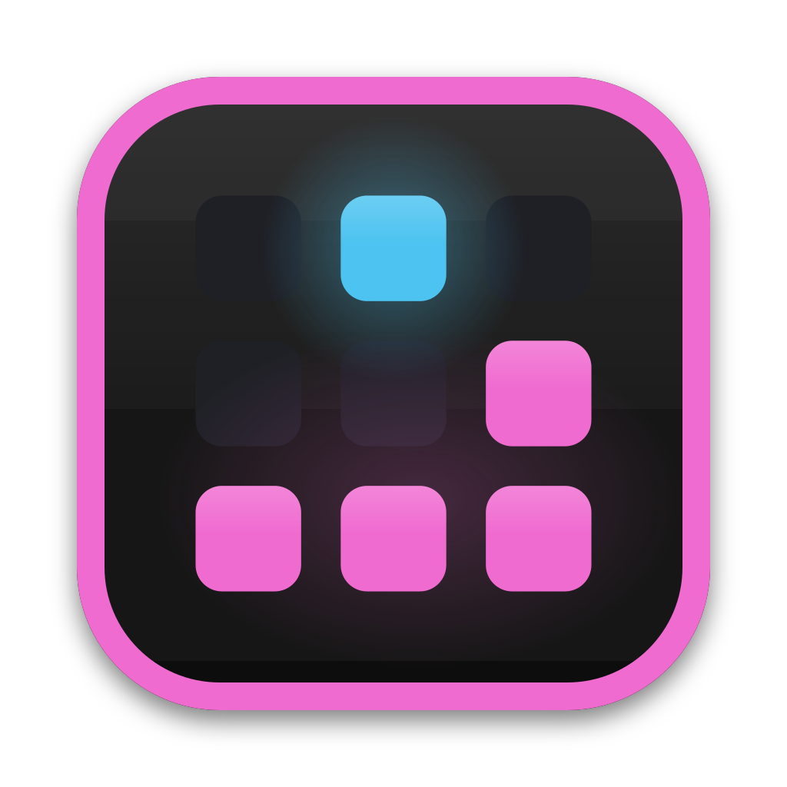
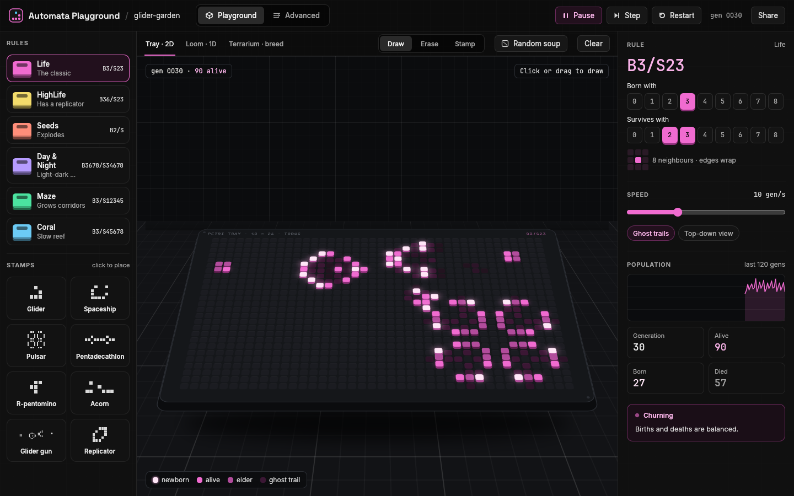
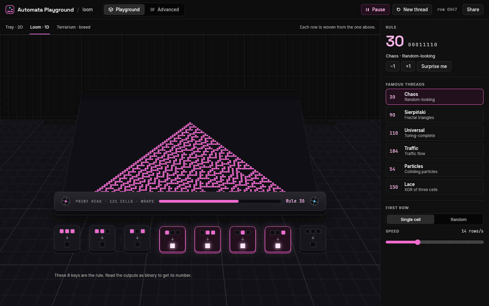
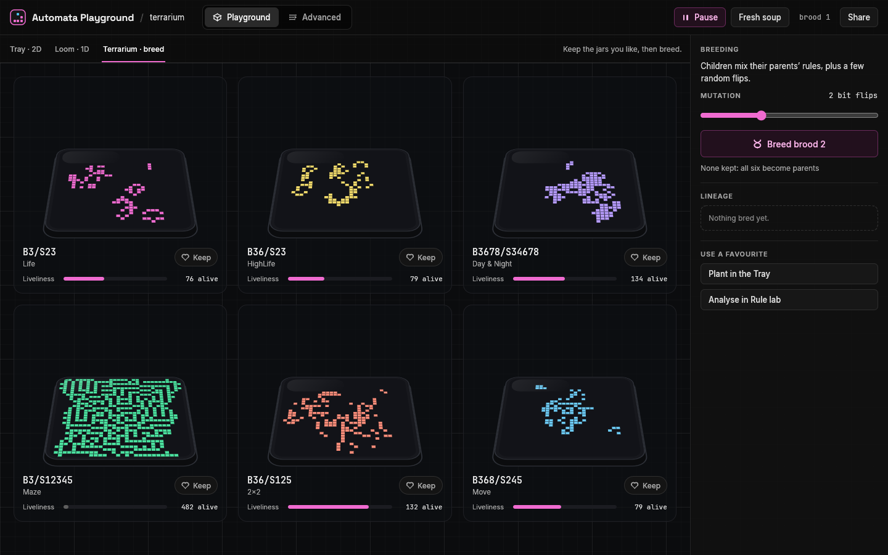
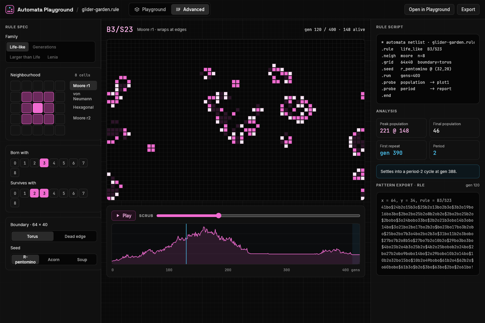
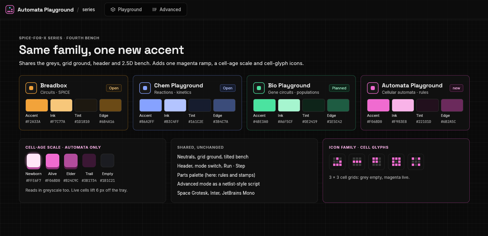

<p align="center">

</p>
<h1 align="center">Automata Playground</h1>
<p align="center"><b>A very fun, very serious cellular-automata playground.</b><br>Life-like rules on a 2.5D Petri tray, elementary rules woven row by row, rules bred in jars, and a rule lab with a netlist-style script — one native macOS app, written in Rust.</p>
<p align="center"></p>

## What is it?

Automata Playground is the fourth bench in the **lab series** ("SPICE for X"), next to
[Breadbox](../breadbox) (circuits) and [Chem Playground](../chem-playground) (chemistry), with
Bio Playground planned. It shares their greys, graph-paper ground, header, 2.5D bench and
fonts, and adds one magenta accent ramp, a cell-age scale and cell-glyph icons.

- **Playground** — three benches you play with: the **Tray** (Life-like rules on a tilted
  Petri tray: draw, stamp, run), the **Loom** (Wolfram's elementary rules, woven into fabric)
  and the **Terrarium** (six jars of rules you breed by keeping the ones you like).
- **Advanced** — the **Rule lab**: specify a rule and its neighbourhood, run 400 generations,
  scrub through them, read the analysis (peak, final, first exact repeat, period), and edit
  the whole experiment as a text script.

Every number on screen comes from the engine (`ap-engine`); the mockup's own numbers are
reproduced exactly as golden tests.

## A quick tour

<table>
<tr><td width="50%"><br><sub><b>Loom · 1D</b> — eight rule keys, a print head, rule 30 weaving its chaos.</sub></td><td width="50%"><br><sub><b>Terrarium · breed</b> — six jars, each running its own rule; keep favourites and breed.</sub></td></tr>
<tr><td><br><sub><b>Rule lab</b> — spec, top-down run, population plot with the stable band, script, analysis, RLE.</sub></td><td><br><sub><b>Series</b> — the lab series' identities; open a sibling app from here.</sub></td></tr>
</table>

## Features

**Tray · 2D**
- A 40 × 26 torus drawn in 2.5D (tilted 44°, cells lifted 6 px, the cell-age scale: newborn,
  alive, elder, ghost trails), with a 0.4 s "Top-down view" transition.
- Draw, Erase and Stamp tools — the pointer hits cells exactly through the perspective; the
  grid is keyboard-operable too (arrow keys and Space / Enter).
- Six rule cartridges (Life, HighLife, Seeds, Day & Night, Maze, Coral), Born / Survives bits,
  eight stamps (glider to Gosper gun and the HighLife replicator).
- Run / Pause, Step, Restart, Random soup, Clear, 1–30 gen/s; a 120-generation population
  sparkline, Generation / Alive / Born / Died tiles and a "what is happening" mood.
- Share copies the tray as RLE; paste (⌘V) or drop an `.rle` / `.cells` file, or open one from
  Finder, and it becomes a stamp.

**Loom · 1D**
- Any elementary rule 0–255 on 121 wrapping cells; the newest 72 rows as fabric on a tilted
  board, a print head with spinning spools and a progress bar.
- Eight rule keys (111 → 000) that flip the rule's bits, −1 / +1 / Surprise me, six famous
  threads (30, 90, 110, 184, 54, 150), single-cell or random first row, 2–40 rows/s.
- Share copies "Rule N" and the visible rows as text.

**Terrarium · breed**
- Six 32 × 32 jars running Life, HighLife, Day & Night, Maze, 2×2 and Move from soups, each in
  its own ink, with a liveliness meter and population.
- Keep favourites, then breed: kept jars carry over, the rest are children whose birth /
  survival bits come from random parents, plus 1–4 mutations. A lineage lists each brood's
  parents.
- Plant in the Tray / Analyse in Rule lab hand the chosen rule to the other screens.

**Rule lab**
- Life-like rules on any neighbourhood inside 5 × 5 (Moore, von Neumann, hexagonal, Moore r2 or
  your own cells), torus or dead edges on a 64 × 40 grid, R-pentomino / acorn / soup seeds.
- 400 generations, a scrubber and Play, a top-down view (born, alive, died as ghosts), the
  population plot with the stable band from the first repeat.
- Analysis with exact repeat detection: peak, final, first repeat, period and a verdict.
- The **rule script** is editable: change the text and the spec follows, change the spec and
  the text follows; errors are shown per line and the last valid script stays in effect.
- Export: copy RLE or the script, save `.rle` / `.rule`, or open the scrubbed generation in
  the Tray.

**Everywhere**: the header's mode switcher, ⌘1–⌘4, Tab / Shift-Tab through every
control, Space runs and pauses, `S` steps the Tray; every control is an AccessKit button,
link, tab, slider or text field with a name, and every canvas describes itself; panels stack
and the page scrolls on narrow windows (down to 390 px).

## Run

```sh
export PATH="$HOME/.cargo/bin:$PATH"     # rustup's toolchain, not an older Homebrew rustc
cargo run --release -p automata-playground
```

Or build the app bundle: `scripts/bundle-macos.sh` → `dist/Automata Playground.app` (add
`--dmg` for a disk image, `--check` to verify it). macOS on Apple Silicon is what's built and
tested; you need [Rust via rustup](https://rustup.rs) (`rust-toolchain.toml` selects stable).
The sibling `../labkit` checkout must be next to this one (shared theme, UI and MCP crates).

`automata-playground --smoke 5` runs the Tray for five seconds and prints a one-line report
(start-up time, frames, generations).

## Test

```sh
scripts/test-all.sh            # fmt, shellcheck, clippy -D warnings, every test, perf gates, bundle
scripts/test-all.sh --quick    # without the release perf gates and the bundle
```

The suite has engine unit, reference and golden tests (the mockup's JavaScript re-run for its
numbers), GUI tests that drive every screen with `egui_kittest` through AccessKit,
end-to-end journeys across screens (`crates/automata-playground/tests/journeys.rs`), closeness
bounds against the mockup's references at 1440 and 390 px, and MCP tests that spawn the real
server. To look at the app next to the mockup:

```sh
scripts/compare-mockup.sh          # target/compare/<Screen>-1440.png / -390.png, [app | mockup]
scripts/screenshots.sh             # re-renders docs/screenshots/*.png
```

## MCP server

`automata-mcp` lets AI agents run automata headless (run a rule on a pattern, analyse a rule,
weave an elementary rule, parse rules and patterns) and look at and drive the running app
(status, navigate, screenshot, describe, the Tray / Loom / Terrarium / Rule lab controls).
See [`crates/ap-mcp/README.md`](crates/ap-mcp/README.md) for building it and adding it to
Claude Code or Claude Desktop.

## Add your own

The built-in content lives in `ap-engine` tables; the screens list whatever is there.

| To add | Edit | Notes |
|---|---|---|
| A rule cartridge (Tray) | `CARTRIDGES` in [`crates/ap-engine/src/presets.rs`](crates/ap-engine/src/presets.rs) | `Cartridge { id, name, note, rule: LifeRule::moore(&[born…], &[survives…]) }`; bump the array length. Its body colour cycles through `ap_theme::CART_BODIES`. |
| A stamp (Tray) | `STAMPS` in [`crates/ap-engine/src/pattern/library.rs`](crates/ap-engine/src/pattern/library.rs) | `Stamp { id, name, rows: &[".O.", "..O", "OOO"] }` (`O` alive, `.` empty). Its tile previews the cells. |
| A famous thread (Loom) | `FAMOUS` in [`crates/ap-engine/src/elementary.rs`](crates/ap-engine/src/elementary.rs) | `FamousThread { rule, name, note }`; the rule's blurb becomes "Name · Note". |
| A Terrarium name | `NAMED` in [`crates/ap-engine/src/presets.rs`](crates/ap-engine/src/presets.rs) | `("Name", LifeRule::moore(…))`; jars with that rule show the name instead of "Mutant". `TERRARIUM_START` picks the six starting rules. |

The shipped sets are pinned to the mockup's (SPEC TRAY-4/5, LOOM-5, TERR-1), so an addition
fails the engine's preset and golden tests on purpose (for cartridges and stamps:
`presets::tests::cartridges_match_the_mockup` and `tests/golden.rs`
`cartridges_and_stamps_are_the_mockups`): update those expectations, and any GUI test that
counts the list (`cargo test -p automata-playground`), with the change, then re-render
`scripts/screenshots.sh`.

## Project layout

```
crates/
  ap-engine/            the automata engine, no UI: rules and neighbourhoods, grids with cell
                        ages and trails, RLE / plaintext patterns, elementary CA, analysis with
                        exact repeats, the mood classifier, breeding, the rule script
  ap-bench/             the 2.5D bench drawing (CSS-style perspective with inverse hit-testing):
                        floor, tray, loom fabric and keys, jars, the top-down grid
  ap-theme/             Automata's tokens on top of labkit's lab-theme
  automata-playground/  the egui app: header, router, layout, widgets, the five screens, the
                        MCP bridge, --smoke; tests/ has the GUI suites and the journeys
  ap-shared/, ap-mcp/   the MCP protocol types and the automata-mcp server
docs/                   ARCHITECTURE.md (crate contracts, screen control APIs), the design
                        mockup and its references, screenshots
scripts/                test-all, bundle-macos / check-bundle, compare-mockup, screenshots,
                        mockup-goldens.mjs
```

[`SPEC.md`](SPEC.md) is the definition of done (every requirement has an ID the tests cite),
[`docs/ARCHITECTURE.md`](docs/ARCHITECTURE.md) the map of the code, and
[`PROGRESS.md`](PROGRESS.md) the work log.

## The lab series

Each bench is a playground on top of a serious engine: Breadbox puts a SPICE engine and real
Arduino firmware under a breadboard, Chem Playground a reaction-kinetics engine under a
glassware bench, and Automata Playground an exact cellular-automata engine under a Petri tray.
They share [`labkit`](../labkit) (fonts and egui style, layout maths and graph-paper ground,
the MCP server and live bridge), a look and the Playground / Advanced split.

MIT licensed.
